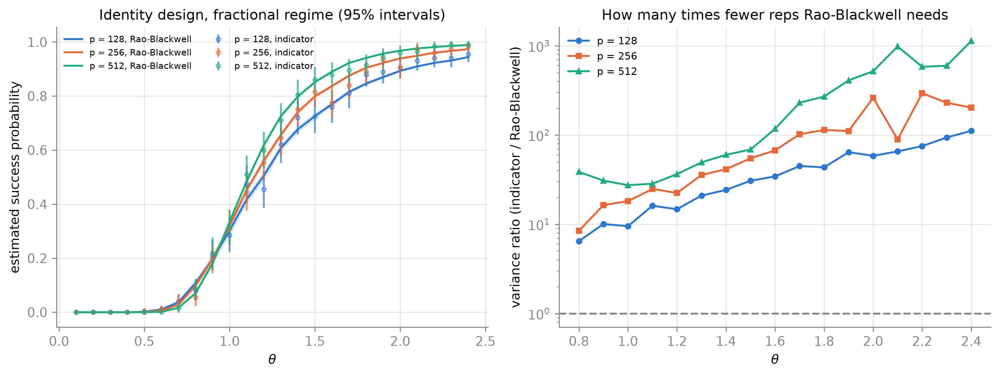

# Extensions

## Rao-Blackwellized estimate of the success probability (identity design)

**Idea.** The main study estimates the success probability by the average of a 0/1 indicator. In the
identity design the off-support columns $X_j$ ($j \notin S$) are i.i.d. $N(0, I_n)$ and independent of
$(X_S, w)$. Given $X_S$ and $w$, the restricted solution $\check\beta_S$ and the residual
$r = y - X_S\check\beta_S$ are fixed, so $z_j = X_j^\top r/(n\lambda_n)$ are i.i.d.
$N(0, \lVert r\rVert^2/(n\lambda_n)^2)$ and

$$
P(\text{success} \mid X_S, w) = \mathbf{1}\{\text{signs correct}\}\,\bigl(2\Phi(n\lambda_n/\lVert r\rVert) - 1\bigr)^{p-k}.
$$

Averaging this conditional probability instead of the indicator is still unbiased, and its variance is
never larger (Rao-Blackwell theorem). It is computed as $\exp\{(p-k)\,\mathrm{log1p}(-2\Phi(-t))\}$,
which stays accurate when $\Phi(-t)$ is tiny.

**Method.** `src/rao_blackwell.py` (`make rao-blackwell`, about 15 s on all cores) computes both estimates
on the same replicates (identity design, all regimes, $p$ and $\theta$, 200 reps, same seeds as the main
study). Output: `results/extensions/rao_blackwell.csv`.

**Results.**
- The indicator reproduces the main study's success rates exactly in all 216 identity-design conditions.
- In the transition region (success probability between 0.05 and 0.95, 119 conditions), the variance
  ratio (indicator / Rao-Blackwell) has median **58.6** (range 6.3-796). So 200 Rao-Blackwell reps are
  about as precise as 12,000 indicator reps. Median by regime: linear 108.7, fractional 42.4, sublinear 32.0.
  Since one replicate costs about the same either way, the same precision needs far less computation:
  for example, 20 Rao-Blackwell reps take 10x less time than 200 indicator reps and are still about 6x
  more precise (median).
- The ratio grows with $\theta$ and with $p$ (right panel): $(p-k)$ independent coordinates make the
  conditional probability a smooth function of $\lVert r\rVert$, while the indicator stays 0/1.
- Unbiasedness check: with 5,000 reps on the three conditions where the two estimates differed most at
  200 reps, they agree within 0.5 standard errors.

**Limits.** The formula needs independent Gaussian off-support columns. It does not apply to the Toeplitz
designs ($X_{S^c}$ is correlated with $X_S$, so the $z_j$ are dependent and the probability has no closed
form) or to the sparse design (non-Gaussian entries). Since the estimate does not use $X_{S^c}$, the
off-support columns would not need to be drawn at all ($nk$ instead of $np$ random numbers); this was not
done because it changes the random draws of the main study.
