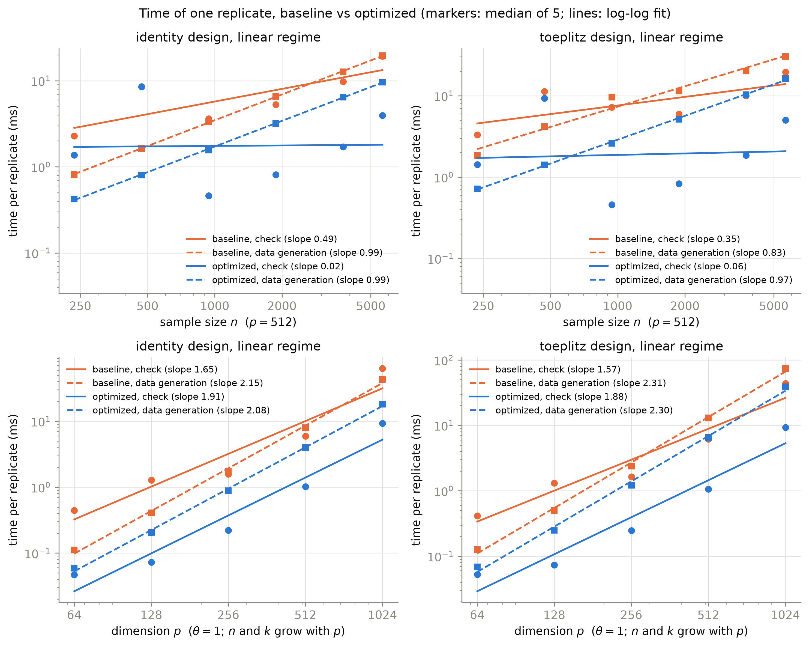

# Optimizations

Starting point: the Unit 2 code (tag `unit2-baseline`); measurements in [BASELINE.md](BASELINE.md).
Hardware: Apple M5 (4 performance + 6 efficiency cores), 16 GB RAM.

## Summary

| Version | Full study (172,800 replicates) | Speedup |
|---|---:|---:|
| Baseline (Unit 2), 1 core | 446.4 s | 1.00x |
| Optimized, all cores (`make parallel`) | **92.8 s** | **4.81x** |

Step by step (`python -m src.simulation --n-reps 10`, all 864 conditions, 8,640 replicates):

| Step | Change | Category | Time (s) | Speedup |
|---|---|---|---:|---:|
| 0 | Baseline (Unit 2) | | 22.3 | 1.00x |
| 1 | Closed-form PDW with Cholesky and a singularity guard | algorithmic, numerical stability | 17.0 | 1.31x |
| 2 | No column copies in the dual step | algorithmic / array programming | 14.3 | 1.56x |
| 3 | Parallel conditions (joblib, all cores) | parallelization | 6.8 | 3.28x |
| - | Toeplitz design via AR(1) recursion | tried, rejected | slower | - |


**Correctness:** `tests/test_regression.py` checks that both versions give exactly the same results
(per-replicate success/failure, per-condition success rates, serial = parallel), including the edge
cases n <= k and singular X_S. Differences in the full study are explained [at the end](#differences-from-the-unit-2-results).

---

## 1. Closed-form PDW with Cholesky and a singularity guard

**Problem.** The sklearn Lasso fit on $X_S$ took 31% of the time (cProfile). A closed-form solve with
`np.linalg.solve` raises `LinAlgError` when $X_S$ is singular (sparse design, small $n$).

**Solution.** With the signs fixed to $\mathrm{sign}(\beta^*_S)$, Step 1 of the PDW is the linear system

$$
(X_S^\top X_S)\,\check{\beta}_S = X_S^\top y - n\lambda_n\,\mathrm{sign}(\beta^*_S),
$$

which gives the same success/failure result as the restricted Lasso (Lemma 3). It is solved by a
Cholesky factorization $X_S^\top X_S = LL^\top$, which also detects a singular $X_S^\top X_S$; that
case is reported as failure, as the baseline does. New class `PDWFast` in `src/methods.py`.

```python
# before (PDWRestrictedLasso): iterative solver
beta_check_S, converged = _lasso_fit_status(X_S, y, lam, tol=1e-10)   # sklearn Lasso(...).fit(X_S, y)

# after (PDWFast): one linear solve
try:
    chol = cho_factor(X_S.T @ X_S)
except np.linalg.LinAlgError:              # X_S rank-deficient
    return _failed_check()
beta_check_S = cho_solve(chol, X_S.T @ y - n * lam * z_S)
```

**Impact.** 22.3 s -> 17.0 s (1.31x). Check time at n = 5636, p = 512: 19.3 ms -> 3.7 ms per
replicate. No exceptions on singular $X_S$. Same success/failure result on 8,640 / 8,640 replicates.

**Trade-offs.** Relies on Lemma 3 instead of solving the Lasso directly. Forming $X_S^\top X_S$ squares
the condition number, $\kappa(X_S^\top X_S) = \kappa(X_S)^2$; a QR factorization of $X_S$ would avoid
this at about twice the cost. On failed replicates the PDW diagnostics differ from the
baseline (see the end).

## 2. No column copies in the dual-feasibility step

**Problem.** line_profiler: `X[:, off_support].T @ residual` took 19% of `check`. Fancy indexing
`X[:, off_support]` copies n x (p - k) numbers every replicate.

**Solution.** Multiply with the full `X.T` (a view, no copy) and drop the support entries afterwards;
replace `setdiff1d` by a boolean mask.

```python
# before
off_support = np.setdiff1d(np.arange(p), support)
z_Sc = X[:, off_support].T @ residual / (n * lam)

# after
off_support = np.ones(p, dtype=bool)
off_support[support] = False
z_Sc = (X.T @ residual)[off_support] / (n * lam)
```

**Impact.** `timeit` at n = 5636, p = 512, k = 205: 3.52 ms -> 0.268 ms (13x) for this line.
Whole run 17.0 s -> 14.3 s. Same success/failure result on 8,640 / 8,640 replicates.

**Trade-offs.** Computes k extra entries that are thrown away (k/p of the product); negligible.

## 3. Parallelization across conditions (joblib)

**Problem.** After steps 1-2, 82% of the time is data generation, mostly random number generation.
It cannot be made cheaper without changing the random draws, but the 864 conditions are independent.

**Solution.** Run the conditions in worker processes with `joblib.Parallel` (`--n-jobs`). Every replicate
has its own seed, and joblib returns results in submission order, so the output table is identical to
the serial run.

```python
# before
for cond in tqdm(conditions):
    records.extend(run_condition(cond, config))

# after
results = Parallel(n_jobs=config["n_jobs"], return_as="generator")(
    delayed(run_condition)(cond, config) for cond in conditions)
```

**Impact** (`make benchmark`, 20 reps per condition):

| n_jobs | 1 | 2 | 4 | 6 | 8 | 10 |
|---|---:|---:|---:|---:|---:|---:|
| Time (s) | 29.3 | 20.7 | 13.3 | 11.6 | 9.9 | 10.0 |
| Speedup vs 1 worker | 1.00 | 1.41 | 2.20 | 2.53 | 2.97 | 2.92 |

The speedup is far below the number of workers: the M5 has only 4 performance cores, each worker
pays a start-up cost, and all workers share the memory bandwidth.

**Trade-offs.** One more dependency (joblib); errors inside workers are harder to debug; memory use
grows with the number of workers.

## Tried and rejected: Toeplitz design via AR(1) recursion

Sigma_ij = mu^|i-j| is an AR(1) covariance, so X can be built column by column with
`scipy.signal.lfilter` in O(np) instead of the O(np^2) product `Z @ L.T`, from the same draws Z.
It is slower at the study's sizes (n = 5636, mu = 0.5):

| p | `Z @ L.T` | AR(1) |
|---:|---:|---:|
| 256 | 6.1 ms | 9.1 ms |
| 512 | 14.7 ms | 17.3 ms |
| 1024 | 39.0 ms | 33.4 ms |
| 2048 | 125.2 ms | 66.8 ms |

The product runs in Apple's Accelerate BLAS, while the recursion is sequential, so AR(1) only wins
above p of about 700. The study uses p <= 512, so the optimized code keeps `Z @ L.T`
(`toeplitz_method="ar1"` remains available).

---

## Profiling evidence

cProfile, all 864 conditions with 10 reps each (`make profile`):

| Component | Baseline (s) | Optimized (s) |
|---|---:|---:|
| Data generation | 12.2 | 12.0 |
| PDW check | 12.2 | **2.4** |
| Total | 24.6 | 14.6 |
| Function calls | 14.2 million | 1.5 million |

Time of one replicate vs n and vs p (`make complexity`). The optimized check is about 5x faster and
now grows almost linearly in n (slope 0.88 vs 0.49), because the closed form has no iteration count
that changes with n. Data generation is unchanged and is now the largest cost.



## Lessons learned

- **Best return on investment:** the closed form removed the largest single cost, and the copy fix
  (2 lines) made its line 13x faster. Parallelization gave the largest factor (2.97x) with little code,
  because the Unit 2 seeding rule (one seed per replicate) already made the results independent of
  execution order.
- **Surprises:** half of the baseline time was spent generating data, mostly drawing random numbers, not
  fitting the Lasso; about 40% of the Lasso time was scikit-learn checking its inputs.
- **Not worth the effort:** the AR(1) Toeplitz generator has the better complexity but is slower at
  p <= 512.

## Differences from the Unit 2 results

Full study rerun with the optimized code (`make parallel`, 172,800 replicates) and compared with the Unit 2 tables:
- **Success rates are identical in all 864 conditions**; thresholds, curve collapse and the paper
  comparison agree up to rounding. Figures 1-5 (success curves) are unchanged.
- **PDW diagnostics differ on failed replicates** (`dual_feasible_rate` by up to 0.04, `max_abs_z`
  quantiles, numbers of violations and sign errors). When recovery fails, the baseline's restricted
  Lasso and the closed form (which assumes the true signs) produce different beta_check_S, so they
  certify the failure at different PDW steps. Both are correct by Lemma 3, and on successful replicates
  the diagnostics agree. This changes `fig1_pdw_diagnostics` only.
