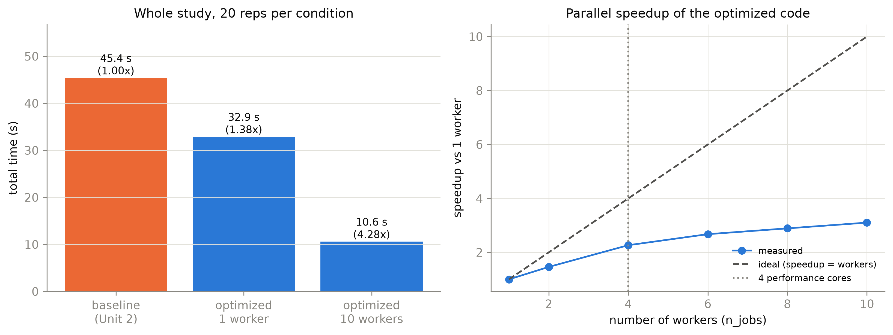

# Optimizations

Starting point: the Unit 2 code (tag `unit2-baseline`); measurements in [BASELINE.md](BASELINE.md).
Hardware: Apple M5 (4 performance + 6 efficiency cores), 16 GB RAM.

## Summary

| Version | Full study (172,800 replicates) | Speedup |
|---|---:|---:|
| Baseline (Unit 2), 1 core | 446.4 s | 1.00x |
| Optimized, all cores (`make parallel`) | **92.8 s** | **4.81x** |

Step by step (`python -m src.simulation --n-reps 10`, all 864 conditions, 8,640 replicates):

| Step | Change | Category | Time (s) | Speedup |
|---|---|---|---:|---:|
| 0 | Baseline (Unit 2) | | 22.3 | 1.00x |
| 1 | Closed-form PDW with Cholesky and a singularity guard | algorithmic, numerical stability | 17.0 | 1.31x |
| 2 | No column copies in the dual step | algorithmic / array programming | 14.3 | 1.56x |
| 3 | Parallel conditions (joblib, all cores) | parallelization | 6.8 | 3.28x |
| - | Toeplitz design via AR(1) recursion | tried, rejected | slower | - |



**Correctness:** `tests/test_regression.py` runs the same small study with both versions. Since the
random draws are unchanged, it checks exact equality (per-replicate success/failure, per-condition
success rates, serial = parallel) instead of a statistical test, plus the edge cases n <= k and
singular X_S. Differences in the full study are explained [at the end](#differences-from-the-unit-2-results).

---

## 1. Closed-form PDW with Cholesky and a singularity guard

**Problem.** The sklearn Lasso fit on X_S took 31% of the time (cProfile); about 40% of that was
scikit-learn input validation, not optimization. The stability check also showed that a closed-form
solve with `np.linalg.solve` raises `LinAlgError` when X_S is singular (29 sparse-design replicates),
while sklearn silently returns a zero coefficient.

**Solution.** With the signs fixed to sign(beta*_S), Step 1 of the PDW is the linear system
(X_S^T X_S) b = X_S^T y - n lam sign(beta*_S), which gives the same success/failure result as the
restricted Lasso (Lemma 3). It is solved by a Cholesky factorization, which also detects a singular
X_S^T X_S. A singular or nearly singular matrix (rank-deficient X_S) is reported as failure, which is
what the baseline reports in all 29 such replicates. New class `PDWFast` in `src/methods.py`.

```python
# before (PDWRestrictedLasso): iterative solver
beta_check_S, converged = _lasso_fit_status(X_S, y, lam, tol=1e-10)   # sklearn Lasso(...).fit(X_S, y)

# after (PDWFast): one linear solve
try:
    chol = cho_factor(X_S.T @ X_S)
except np.linalg.LinAlgError:              # X_S rank-deficient
    return _failed_check()
beta_check_S = cho_solve(chol, X_S.T @ y - n * lam * z_S)
```

**Impact.** 22.3 s -> 17.0 s (1.31x). Check time at n = 5636, p = 512: 19.3 ms -> 3.7 ms per
replicate. Function calls: 14.2 million -> 1.5 million. No exceptions on singular X_S
(`results/profiling/stability_optimized.txt`). Same success/failure result on 8,640 / 8,640
replicates; `max_abs_z` differs by at most 4.8e-11 (sklearn's tolerance).

**Trade-offs.** Relies on Lemma 3 instead of solving the Lasso directly. Forming X_S^T X_S squares the
condition number (up to about 1.2e7 here, so at least 9 of 16 digits remain); a QR factorization of X_S
would avoid this at about twice the cost. On failed replicates the PDW diagnostics differ from the
baseline (see the end).

## 2. No column copies in the dual-feasibility step

**Problem.** line_profiler: `X[:, off_support].T @ residual` took 19% of `check`, and
`X_S @ beta_check_S` on the line above took almost nothing. Fancy indexing `X[:, off_support]`
copies n x (p - k) numbers every replicate; `np.setdiff1d` added another 3%.

**Solution.** Multiply with the full `X.T` (a view, no copy) and drop the support entries afterwards;
replace `setdiff1d` (which sorts) by a boolean mask.

```python
# before
off_support = np.setdiff1d(np.arange(p), support)
z_Sc = X[:, off_support].T @ residual / (n * lam)

# after
off_support = np.ones(p, dtype=bool)
off_support[support] = False
z_Sc = (X.T @ residual)[off_support] / (n * lam)
```

**Impact.** `timeit` at n = 5636, p = 512, k = 205: 3.52 ms -> 0.268 ms (13x) for this line.
Whole run 17.0 s -> 14.3 s. Same success/failure result on 8,640 / 8,640 replicates.

**Trade-offs.** Computes k extra entries that are thrown away (k/p of the product); negligible.

## 3. Parallelization across conditions (joblib)

**Problem.** After steps 1-2, 82% of the time is data generation, mostly random number generation
(cProfile, `results/profiling/optimized_cprofile.txt`). It cannot be made cheaper without changing the
random draws, but the 864 conditions are independent.

**Solution.** Run the conditions in worker processes with `joblib.Parallel` (`--n-jobs`). Every replicate
has its own seed (Unit 2 seeding rule), and joblib returns results in submission order, so the output
table is identical to the serial run (`assert_frame_equal` on all rows).

```python
# before
for cond in tqdm(conditions):
    records.extend(run_condition(cond, config))

# after
results = Parallel(n_jobs=config["n_jobs"], return_as="generator")(
    delayed(run_condition)(cond, config) for cond in conditions)
```

**Impact** (`make benchmark`, 20 reps per condition; `results/profiling/benchmark_20reps.csv`):

| n_jobs | 1 | 2 | 4 | 6 | 8 | 10 |
|---|---:|---:|---:|---:|---:|---:|
| Time (s) | 29.3 | 20.7 | 13.3 | 11.6 | 9.9 | 10.0 |
| Speedup vs 1 worker | 1.00 | 1.41 | 2.20 | 2.53 | 2.97 | 2.92 |

The speedup is far below the number of workers: the M5 has only 4 performance cores, each worker
pays a start-up cost (new process and imports; with 10 reps per condition, more than 4 workers did
not help at all), and all workers generate large random matrices at once and share the memory bandwidth.

**Trade-offs.** One more dependency (joblib); errors inside workers are harder to debug; each worker
holds its own arrays, so memory use grows with the number of workers (not measured).

## Tried and rejected: Toeplitz design via AR(1) recursion

Sigma_ij = mu^|i-j| is an AR(1) covariance, so X can be built column by column with
`scipy.signal.lfilter` in O(np) instead of the O(np^2) product `Z @ L.T`, from the same draws Z
(X agrees to 1e-15). It is slower at the study's sizes (n = 5636, mu = 0.5):

| p | `Z @ L.T` | AR(1) | random draws alone |
|---:|---:|---:|---:|
| 256 | 6.1 ms | 9.1 ms | 4.5 ms |
| 512 | 14.7 ms | 17.3 ms | 9.1 ms |
| 1024 | 39.0 ms | 33.4 ms | 18.3 ms |
| 2048 | 125.2 ms | 66.8 ms | 36.5 ms |

The product runs in Apple's Accelerate BLAS, while the recursion is sequential, so AR(1) only wins
above p of about 700. The study uses p <= 512, so the optimized code keeps `Z @ L.T`
(`toeplitz_method="ar1"` remains available and is tested).

---

## Profiling evidence

cProfile, all 864 conditions with 10 reps each (`make profile`):

| Component | Baseline (s) | Optimized (s) |
|---|---:|---:|
| Data generation | 12.2 | 12.0 |
| PDW check | 12.2 | **2.4** |
| Total (profiled) | 24.6 | 14.6 |
| Function calls | 14.2 million | 1.5 million |

Time of one replicate vs n and vs p (`make complexity`). The optimized check is about 5x faster and
now grows almost linearly in n (slope 0.88 vs 0.49), because the closed form has no iteration count
that changes with n. Data generation is unchanged and is now the largest cost.


## Lessons learned

- **Best return on investment:** the closed form (about 20 lines) removed the largest single cost, and
  the copy fix (2 lines) made its line 13x faster. Parallelization gave the largest factor (2.97x) with
  little code, because the Unit 2 seeding rule (one seed per replicate) already made the results
  independent of execution order.
- **Surprises:** half of the baseline time was spent generating data, mostly drawing random numbers, not
  fitting the Lasso; about 40% of the Lasso time was scikit-learn checking its inputs; seeding, which
  I expected to be slow, took under 1%. cProfile could not see inside numpy operators or the Cython
  random generator, so line_profiler was needed to find the column copies.
- **Not worth the effort:** the AR(1) Toeplitz generator has the better complexity but is slower at
  p <= 512; more than 8 workers did not help.
- **Remaining bottleneck:** random number generation (82% of serial time). Reducing it would require
  changing the random draws (e.g. float32 or a different generator), which would change the results.

## Differences from the Unit 2 results

Full study rerun with the optimized code (`make parallel`, 172,800 replicates) and compared with the Unit 2 tables:
- **Success rates are identical in all 864 conditions**; thresholds, curve collapse and the paper
  comparison agree up to rounding (<= 2e-16). Figures 1-5 (success curves) are unchanged. The PNGs of
  Figs. 2, 3 and 5 differ in at most 45 pixels by 1/255 in brightness (rounding); their PDFs are byte-identical.
- **PDW diagnostics differ on failed replicates** (`dual_feasible_rate` by up to 0.04, `max_abs_z`
  quantiles, numbers of violations and sign errors). When recovery fails, the baseline's restricted
  Lasso and the closed form (which assumes the true signs) produce different beta_check_S, so they
  certify the failure at different PDW steps. Both are correct by Lemma 3, and on successful replicates
  the diagnostics agree (max_abs_z within 1e-8, `tests/test_regression.py`). This changes
  `fig1_pdw_diagnostics` only. Singular X_S (n <= k, or rank-deficient X_S in the sparse design)
  now gives NaN diagnostics.
